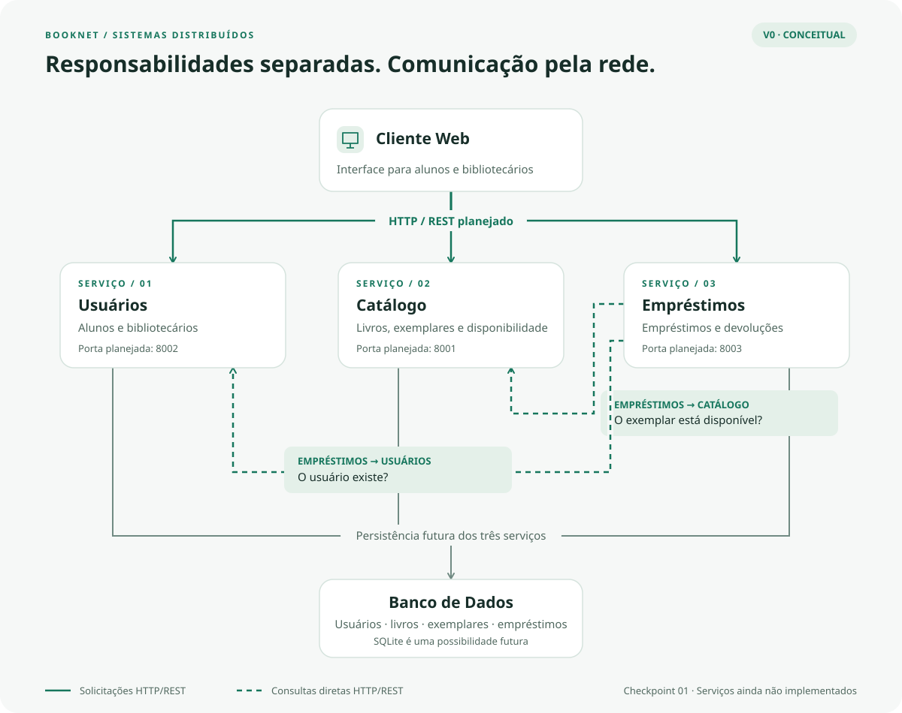

# BookNet

**Sistema Distribuído de Gerenciamento de Biblioteca Universitária**  
Disciplina: Sistemas Distribuídos  
Etapa atual: **V1 — Cliente-servidor concluída**

Entregas concluídas: **Checkpoint 01 / V0 (Ideia e arquitetura)** e **V1 (Cliente-servidor)**

## Integrantes

- André
- João Henrique
- Luiz Felipe

## Sobre o projeto

O BookNet é um projeto acadêmico da disciplina de Sistemas Distribuídos voltado ao gerenciamento de uma biblioteca universitária. O desenvolvimento é incremental ao longo do semestre, e cada versão se relaciona aos conceitos estudados em aula.

A V0 reuniu a proposta, a arquitetura conceitual e um dashboard estático de apresentação. A V1 entrega a primeira implementação cliente-servidor completa: uma API FastAPI com catálogo (livros e exemplares), usuários, empréstimos e devoluções, persistida em PostgreSQL no Neon. Ela também inclui um **Cliente Web funcional** que consome essa API pelo navegador. A V1 também resolve, no banco, a falha de concorrência documentada na V0: dois usuários disputando o mesmo exemplar.

Serviços separados, mensagens/sockets, Docker, recuperação de falhas e orquestração continuam planejados para as próximas versões (V2 a V6).

## Problema

Uma biblioteca universitária precisa manter informações coerentes sobre seus usuários, acervo e circulação de exemplares. Esse gerenciamento envolve:

- Identificar os usuários e distinguir alunos de bibliotecários.
- Organizar os dados dos livros, como título, autor e ISBN.
- Diferenciar cada livro de seus exemplares físicos e acompanhar a disponibilidade de cada exemplar.
- Relacionar empréstimos a usuários e exemplares, registrando datas e previsão de devolução.
- Registrar devoluções e refletir a disponibilidade do exemplar para novos empréstimos.

Ao distribuir essas responsabilidades, o projeto também precisa considerar a comunicação pela rede e situações em que os componentes recebem solicitações simultâneas ou deixam de responder.

## Objetivo

O objetivo geral é desenvolver um sistema de gerenciamento de biblioteca universitária que organize usuários, livros, exemplares, empréstimos e devoluções em componentes com responsabilidades definidas.

O objetivo acadêmico é estudar comunicação entre processos e distribuição de responsabilidades, observando seus efeitos sobre concorrência, consistência, disponibilidade, escalabilidade e tolerância a falhas.

## Usuários

| Perfil | Funcionalidades | Situação na V1 |
| --- | --- | --- |
| **Aluno** | Pesquisar livros, verificar disponibilidade, solicitar empréstimos, realizar devoluções e consultar seus empréstimos. | Operações disponíveis na API e no Cliente Web. |
| **Bibliotecário** | Cadastrar e alterar livros e exemplares, consultar usuários e acompanhar empréstimos. | Operações disponíveis na API e no Cliente Web. |

Ainda não há login nem controle de permissões por perfil: qualquer pessoa com acesso ao Cliente Web executa todas as operações. Autenticação está fora do escopo da V1.

## Fora do escopo inicial

- Pagamentos.
- Multas complexas.
- Recomendação com IA.
- Aplicativo mobile.
- Reconhecimento facial.
- Integrações externas.

## Arquitetura



A arquitetura planejada possui cinco componentes: **Cliente Web**, **Serviço de Usuários**, **Serviço de Catálogo**, **Serviço de Empréstimos** e **Banco de Dados**. A [documentação da arquitetura](docs/arquitetura.md) preserva o registro da V0.

### Como a V1 implementa essa arquitetura

```text
 Navegador (Cliente Web, porta 8080)
        │  HTTP/REST + JSON (fetch, CORS)
        ▼
 API FastAPI + Uvicorn (porta 8000)
 ├── routers/catalogo.py     → /livros, /exemplares     (papel do Serviço de Catálogo)
 ├── routers/usuarios.py     → /usuarios                (papel do Serviço de Usuários)
 └── routers/emprestimos.py  → /emprestimos             (papel do Serviço de Empréstimos)
        │  SQLAlchemy + psycopg (protocolo PostgreSQL, pela internet)
        ▼
 PostgreSQL no Neon (tabelas livros, exemplares, usuarios, emprestimos)
```

Na V1, os três "serviços" são **módulos (routers) dentro de uma única aplicação**. Cada um tem responsabilidade própria, mas todos rodam no mesmo processo. Por isso, a verificação "o usuário existe? o exemplar está disponível?" feita por Empréstimos ainda é uma consulta direta ao banco, não uma chamada HTTP. A separação em processos independentes nas portas 8001, 8002 e 8003, com comunicação HTTP entre eles, é o objetivo da **V3**.

## Modelos implementados

| Modelo / tabela | Campos | Regras principais |
| --- | --- | --- |
| `Livro` / `livros` | `id`, `titulo`, `autor`, `isbn`, `ativo`, `criado_em`, `atualizado_em` | ISBN único (string até 20); título e autor obrigatórios até 255; `ativo` padrão `true`. |
| `Exemplar` / `exemplares` | `id`, `livro_id`, `codigo_tombo`, `status`, `criado_em` | Livro obrigatório (FK `RESTRICT`); código de tombo único; status `DISPONIVEL` ou `EMPRESTADO`. Todo exemplar nasce `DISPONIVEL`. |
| `Usuario` / `usuarios` | `id`, `nome`, `email`, `matricula`, `tipo`, `ativo`, `criado_em`, `atualizado_em` | E-mail e matrícula únicos; e-mail normalizado em minúsculas; tipo `ALUNO` ou `BIBLIOTECARIO`. |
| `Emprestimo` / `emprestimos` | `id`, `usuario_id`, `exemplar_id`, `data_emprestimo`, `data_prevista_devolucao`, `data_devolucao`, `status` | Status `ATIVO` ou `DEVOLVIDO`; `data_devolucao` vazia se e somente se `ATIVO`; **no máximo um empréstimo ATIVO por exemplar** (índice único parcial). |

As regras são garantidas em duas camadas. Os schemas Pydantic validam a entrada da API (respondendo `422`), e as constraints do banco (`UNIQUE`, `CHECK`, `FOREIGN KEY`) protegem os dados mesmo contra escritas que não passem pela API. Nenhum registro é excluído: livros e usuários são desativados com `ativo = false`.

## Endpoints

Documentação interativa: [http://127.0.0.1:8000/docs](http://127.0.0.1:8000/docs) (Swagger, versão `1.2.0`, tags `Sistema`, `Catálogo`, `Usuários` e `Empréstimos`).

| Método | Rota | Comportamento |
| --- | --- | --- |
| `GET` | `/` | Identificação: `{"projeto":"BookNet","status":"online","versao":"V1"}`. |
| `GET` | `/health` | API respondendo: `{"status":"ok"}`. |
| `GET` | `/health/database` | `SELECT 1` no banco: `200 online` ou `503 offline`. |
| `GET` | `/livros` | Lista livros ativos; `q` pesquisa título, autor e ISBN; paginação `skip`/`limit`. |
| `GET` | `/livros/{id}` | Consulta um livro (inclusive inativo). |
| `POST` | `/livros` | Cadastra livro (`201`; `409` se o ISBN já existe). |
| `PUT` | `/livros/{id}` | Substitui os dados do livro (também usado para desativar). |
| `GET` | `/livros/{id}/exemplares` | Lista os exemplares do livro e seus status. |
| `POST` | `/livros/{id}/exemplares` | Cadastra exemplar (`409` se o tombo já existe). |
| `GET` | `/exemplares/{id}` | Consulta a disponibilidade de um exemplar. |
| `GET` | `/usuarios` | Lista usuários ativos; `q` pesquisa nome, e-mail e matrícula; filtro `tipo`. |
| `GET` | `/usuarios/{id}` | Consulta um usuário. |
| `POST` | `/usuarios` | Cadastra usuário (`409` para e-mail ou matrícula repetidos). |
| `PUT` | `/usuarios/{id}` | Substitui os dados do usuário (também usado para desativar). |
| `GET` | `/emprestimos` | Lista empréstimos, mais recentes primeiro; filtros `usuario_id`, `status` e `atrasados=true`. |
| `GET` | `/emprestimos/{id}` | Consulta um empréstimo. |
| `POST` | `/emprestimos` | Registra empréstimo: `{"usuario_id":1,"exemplar_id":4,"prazo_dias":14}`. |
| `POST` | `/emprestimos/{id}/devolucao` | Registra a devolução e libera o exemplar. |

As respostas de empréstimo incluem o nome do usuário, o título do livro, o código de tombo e o campo calculado `atrasado`. Assim, o cliente exibe tudo com uma única requisição.

### Regras de empréstimo

Um empréstimo é aprovado somente se:

1. O usuário existe (`404`) e está ativo (`409`).
2. O usuário tem menos de **3 empréstimos ativos** (`409`).
3. O usuário **não tem empréstimo em atraso** (`409`).
4. O exemplar existe (`404`), pertence a um livro ativo (`409`) e está **disponível** (`409`).

O prazo padrão é de 14 dias, configurável de 1 a 60 em `prazo_dias`. A devolução muda o empréstimo para `DEVOLVIDO`, registra `data_devolucao` e devolve o exemplar a `DISPONIVEL`, tudo na mesma transação. Devolver duas vezes retorna `409`.

### Concorrência: a falha 2 da V0 resolvida

A V0 documentou o cenário em que *"dois usuários tentam pegar o mesmo exemplar ao mesmo tempo"*. A V1 trata esse cenário em três níveis:

1. **UPDATE condicional atômico:** a retirada executa `UPDATE exemplares SET status='EMPRESTADO' WHERE id=:id AND status='DISPONIVEL'`. O PostgreSQL bloqueia a linha. A primeira transação altera o status, e a segunda reavalia a condição após o commit da primeira, encontra 0 linhas e recebe `409 Exemplar não está disponível`. Não existe intervalo entre "verificar" e "alterar".
2. **Índice único parcial** `uq_emprestimos_exemplar_ativo` (`UNIQUE (exemplar_id) WHERE status = 'ATIVO'`): mesmo que algum código futuro esqueça o passo 1, o banco recusa um segundo empréstimo ativo. A transação é desfeita por completo.
3. **`SELECT ... FOR UPDATE` no usuário:** serializa pedidos simultâneos do mesmo usuário, para que o limite de 3 empréstimos não seja ultrapassado.

O script `scripts/teste_concorrencia.py` demonstra isso contra o banco real. Ele dispara pedidos **simultâneos** de todos os usuários para o mesmo exemplar e confere o resultado. Saída registrada no Neon:

```text
  Luiz Felipe               HTTP 201  empréstimo 1
  João Henrique             HTTP 409  Exemplar não está disponível.
  Bibliotecária BookNet     HTTP 409  Exemplar não está disponível.
  André                     HTTP 409  Exemplar não está disponível.

Pedidos simultâneos: 4 | aprovados: 1
RESULTADO: OK - apenas um empréstimo registrado.
```

### Erros e segurança

| Situação | Resposta |
| --- | --- |
| Entrada inválida | `422` (validação padrão do FastAPI). |
| Recurso inexistente | `404`. |
| Duplicidade ou regra de negócio violada | `409` com mensagem clara (ex.: `E-mail já cadastrado.`). |
| Outras violações de integridade | `400`. |
| Banco indisponível | `503`. |
| Erro inesperado | `500` com mensagem genérica. |

Respostas e logs nunca incluem SQL, traceback, connection string, host, usuário ou senha. A API usa uma sessão de banco por requisição (`get_db()`), com rollback automático em caso de falha.

## Cliente Web

A pasta `cliente/` contém a interface funcional em HTML, CSS e JavaScript puro, sem dependências. Ela se comunica com a API por `fetch` (HTTP/REST e JSON).

| Aba | O que faz |
| --- | --- |
| **Acervo** | Pesquisa livros, mostra quantos exemplares estão disponíveis, lista exemplares e seus status, cadastra e edita livros e exemplares, e tem o botão **Emprestar** em cada exemplar disponível. |
| **Usuários** | Pesquisa e filtra por tipo, cadastra e edita alunos e bibliotecários, e dá acesso aos empréstimos de cada usuário. |
| **Empréstimos** | Registra empréstimos, lista com filtros (todos, ativos, atrasados, devolvidos) e registra devoluções. |

O cabeçalho mostra em tempo real se a API e o banco estão online, a partir de `/health/database`. Erros da API, como `409 Exemplar não está disponível`, aparecem como notificações. Os textos vindos da API são inseridos com `textContent`, nunca como HTML.

O `dashboard/` continua sendo a apresentação acadêmica estática da V0.

## Como executar

Execute os comandos **na raiz `booknet/`**, no PowerShell.

### 1. Preparar o ambiente (somente na primeira vez)

```powershell
python -m venv .venv
.\.venv\Scripts\python.exe -m pip install -r requirements.txt
```

Crie o arquivo `.env` na raiz `booknet/` com a variável `DATABASE_URL` (connection string do Neon). Esse arquivo é ignorado pelo Git e nunca deve ser enviado ao GitHub.

### 2. Criar ou atualizar as tabelas (migrations)

```powershell
.\.venv\Scripts\python.exe -m alembic upgrade head
.\.venv\Scripts\python.exe -m alembic current
```

O banco do projeto no Neon já está na revisão `0002_usuarios_emprestimos (head)`. Rodar `upgrade head` novamente não altera nada.

### 3. Iniciar a API (terminal 1)

```powershell
.\.venv\Scripts\python.exe -m uvicorn backend.main:app --reload --port 8000
```

### 4. Iniciar o Cliente Web (terminal 2)

```powershell
cd cliente
..\.venv\Scripts\python.exe -m http.server 8080 --bind 127.0.0.1
```

Acesse **[http://127.0.0.1:8080/](http://127.0.0.1:8080/)**. É preciso abrir pelo servidor HTTP, e não com duplo clique no `index.html`: o CORS da API libera apenas as origens `localhost`/`127.0.0.1` nas portas `8080` e `5500`.

### Demonstração em duas máquinas (rede do laboratório)

É a versão do BookNet do aquecimento da Aula 2 ("Computador A servidor, Computador B cliente"). Em vez de servir arquivos soltos, o Computador A roda a API e o Cliente Web, e o Computador B usa a biblioteca só pelo navegador, através da rede.

**Computador A (servidor)**, na raiz `booknet/`:

```powershell
ipconfig                                                               # anote o IPv4, ex.: 192.168.0.101
.\.venv\Scripts\python.exe -m uvicorn backend.main:app --host 0.0.0.0 --port 8000
```

Em outro terminal, **dentro de `cliente/`**:

```powershell
..\.venv\Scripts\python.exe -m http.server 8080 --bind 0.0.0.0
```

**Computador B (cliente)**:

```powershell
ping 192.168.0.101
```

No navegador, abra `http://192.168.0.101:8080`.

```text
Computador B (navegador) ──HTTP :8080──▶ Computador A: arquivos do cliente
Computador B (navegador) ──HTTP :8000──▶ Computador A: API FastAPI ──▶ PostgreSQL no Neon
```

O cliente descobre sozinho o endereço da API: ele usa o mesmo IP pelo qual foi aberto, na porta 8000. O CORS da API aceita origens de redes privadas (`10.x`, `172.16–31.x`, `192.168.x`) nas portas 8080 e 5500, e continua recusando origens da internet.

Cuidados:

- Na primeira execução, o Windows pode perguntar se permite o Python na rede. Permita em **rede privada**. Se o `ping` funcionar mas a página não abrir, o bloqueio é do firewall.
- Use `--bind 0.0.0.0` **somente dentro de `cliente/`**. Servir a raiz `booknet/` exporia o `.env` para a rede.
- Para a demonstração de concorrência, cada integrante pode clicar em **Emprestar** no mesmo exemplar, cada um no seu computador. Só um recebe o empréstimo.

### 5. Dados de demonstração e teste de concorrência (opcional)

Com a API rodando:

```powershell
.\.venv\Scripts\python.exe scripts\popular_dados.py       # 5 livros, 9 exemplares, 4 usuários
.\.venv\Scripts\python.exe scripts\teste_concorrencia.py  # pedidos simultâneos pelo mesmo exemplar
```

`popular_dados.py` pode ser executado várias vezes, porque ignora registros que já existem. Cada execução de `teste_concorrencia.py` cria um exemplar novo (tombo `CONC-...`) no primeiro livro e, ao final, devolve o empréstimo.

## Testes automatizados

```powershell
.\.venv\Scripts\python.exe -m unittest discover -s tests -v
```

**61 testes passando.** Eles usam SQLite em memória e não acessam o `.env` nem o Neon, porque qualquer tentativa de conexão PostgreSQL é bloqueada. Estão organizados assim:

| Arquivo | Cobertura |
| --- | --- |
| `tests/apoio.py` | Infraestrutura compartilhada: banco isolado por teste e cliente HTTP ASGI sem sockets. |
| `tests/test_catalogo.py` | Rotas de sistema, CORS, livros, exemplares, busca, paginação, erros seguros e constraints. |
| `tests/test_circulacao.py` | Usuários, fluxo completo de empréstimo e devolução, indisponibilidade, limite de 3, atraso, usuário e livro inativos, índice único parcial com rollback, filtros e constraints. |

Validações adicionais feitas na entrega:

- `alembic upgrade head` foi aplicado no Neon e `alembic check` não detectou diferenças entre os modelos e o banco.
- `teste_concorrencia.py` foi executado 4 vezes contra o Neon, sempre com exatamente 1 empréstimo aprovado.
- O Cliente Web foi testado no navegador com dados reais da API.

## Estrutura do projeto

```text
booknet/
├── README.md
├── requirements.txt
├── alembic.ini
├── backend/
│   ├── main.py                 # app FastAPI, CORS, rotas de sistema
│   ├── config.py               # leitura do .env
│   ├── database.py             # engine PostgreSQL e sessões
│   ├── errors.py               # respostas de erro seguras
│   ├── dependencies/database.py
│   ├── models/                 # Livro, Exemplar, Usuario, Emprestimo
│   ├── schemas/                # validação Pydantic de entrada e saída
│   └── routers/                # catalogo.py, usuarios.py, emprestimos.py
├── migrations/versions/
│   ├── 0001_catalogo_livros_exemplares.py
│   └── 0002_usuarios_emprestimos.py
├── tests/                      # apoio.py, test_catalogo.py, test_circulacao.py
├── scripts/                    # popular_dados.py, teste_concorrencia.py
├── cliente/                    # Cliente Web funcional (V1)
├── dashboard/                  # apresentação estática (V0)
├── docs/                       # arquitetura e guias de estudo
├── servico-catalogo/           # reservado para a V3
├── servico-usuarios/           # reservado para a V3
├── servico-emprestimos/        # reservado para a V3
└── banco/                      # reservado
```

## Portas

| Componente | Porta | Situação |
| --- | --- | --- |
| API FastAPI | 8000 | Implementada (V1). |
| Cliente Web / dashboard | 8080 | Implementado (servidor estático). |
| Serviço de Catálogo | 8001 | Planejado (V3). |
| Serviço de Usuários | 8002 | Planejado (V3). |
| Serviço de Empréstimos | 8003 | Planejado (V3). |

## Situações de falha

| Falha documentada na V0 | Situação na V1 |
| --- | --- |
| 1. Serviço de Empréstimos indisponível | Ainda não se aplica: os módulos rodam no mesmo processo. A indisponibilidade do **banco** já é detectada e informada com `503`. Será estudada com serviços separados (V3/V5). |
| 2. Dois usuários pedem o mesmo exemplar | **Resolvida**: UPDATE condicional atômico e índice único parcial, demonstrados contra o Neon. |
| 3. Falha de comunicação Empréstimos → Catálogo | Ainda não se aplica, porque não há chamada de rede entre serviços. O conceito de timeout já existe na conexão com o banco (`connect_timeout=10`). Será tratada na V3/V5 com timeout e repetição. |

## Evolução

| Versão | Etapa | Status |
| --- | --- | --- |
| **V0** | **Ideia e arquitetura** | **Concluída** |
| **V1** | **Cliente-servidor** | **Concluída**: API completa, banco no Neon, Cliente Web funcional, concorrência tratada. |
| V2 | Sockets / mensagens | Planejada |
| V3 | Serviços separados | Planejada |
| V4 | Docker | Planejada |
| V5 | Falhas e recuperação | Planejada |
| V6 | Orquestração | Planejada |

## Tecnologias

| Tecnologia | Uso |
| --- | --- |
| Python 3.13 | Linguagem do backend. |
| FastAPI + Uvicorn | API HTTP/REST e servidor ASGI. |
| SQLAlchemy 2 + psycopg 3 | ORM, transações e driver PostgreSQL. |
| Alembic | Migrations versionadas do banco. |
| Pydantic | Validação de entrada e saída. |
| python-dotenv | Leitura do `.env`. |
| PostgreSQL / Neon | Banco de dados na nuvem. |
| HTML, CSS e JavaScript puro | Cliente Web e dashboard, sem frameworks. |
| unittest | Testes automatizados, sem pytest ou httpx. |
| Git / GitHub | Versionamento e hospedagem. |

## Repositório

[github.com/luizfelipefelixalves41-dot/projeto-booknet](https://github.com/luizfelipefelixalves41-dot/projeto-booknet)
